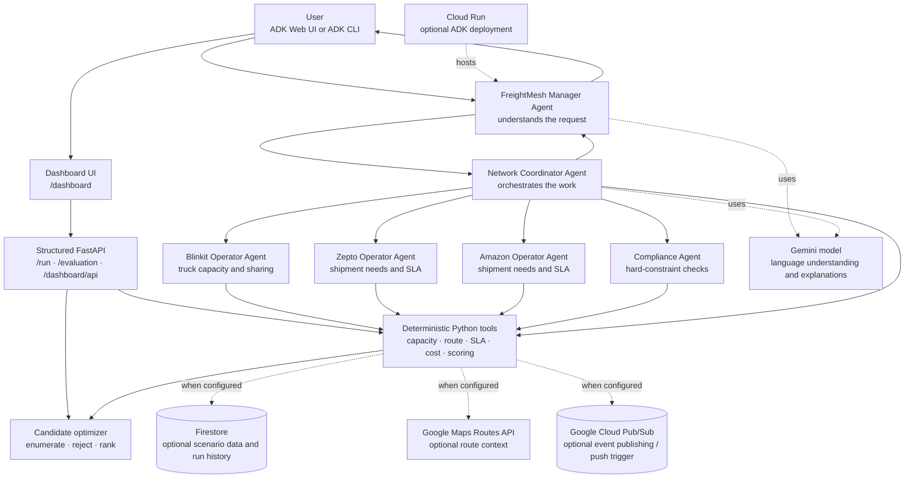

# FreightMesh AI

## Multi-agent freight consolidation with Google ADK

FreightMesh is a Google Agent Development Kit (ADK) application for demonstrating how AI agents representing different logistics companies can coordinate freight. The agents look for shipments that can share a truck, check company and delivery constraints, compare feasible transport plans, and explain a recommendation.

The project is a **simulated hackathon/demo application**, not a live carrier marketplace. Its sample trucks, shipments, ETAs, prices, and emissions are invented demo values. It does not book a shipment or make a real-world dispatch decision.

## Contents

- [Problem and solution](#problem-and-solution)
- [Architecture](#architecture)
- [How an optimization request flows](#how-an-optimization-request-flows)
- [Agents and tools](#agents-and-tools)
- [Use cases](#use-cases)
- [Demo scenario and expected results](#demo-scenario-and-expected-results)
- [Responsible AI dashboard and APIs](#responsible-ai-dashboard-and-apis)
- [Run locally](#run-locally)
- [Connect Google Cloud services](#connect-google-cloud-services)
- [Deploy to Cloud Run](#deploy-to-cloud-run)
- [Project layout](#project-layout)
- [Testing](#testing)
- [Troubleshooting](#troubleshooting)
- [Current scope and next steps](#current-scope-and-next-steps)

## Problem and solution

Freight companies often operate trucks that are only partly loaded, while other companies have shipments on similar routes. A shipment that needs its own vehicle might fit in another company's available capacity, but finding a valid match requires checking several constraints at once:

- Is the truck travelling the right direction and route?
- Is there enough usable capacity?
- Can the cargo share the vehicle?
- Will each shipment meet its deadline?
- Is sharing actually cheaper or more sustainable?
- Will each company agree to the proposed arrangement?

FreightMesh demonstrates a network of role-based agents that ask one another for information and collaborate on a plan. **Gemini/ADK coordinates and explains. Deterministic Python tools do the arithmetic and enforce hard constraints.**

## Architecture

### Agent and service architecture



### Important design choice

The LLM is **not** the source of numerical truth. The optimizer and business tools determine feasibility and calculate the exact result. The ADK agents interpret the request, consult the right company role, invoke tools, coordinate the workflow, and explain the result. The separate dashboard API takes a stricter route: it accepts only structured planning fields and calls the deterministic optimizer directly, without calling Gemini.

The operator agents are separate ADK agents with different instructions and narrow tools. They demonstrate independent company roles, but this sample does **not** implement production security boundaries or separate customer credentials. Do not put real private logistics data into this demo as-is.

## How an optimization request flows

```mermaid
sequenceDiagram
    actor User
    participant Manager as Manager Agent
    participant Coordinator as Network Coordinator
    participant Operators as Company Operator Agents
    participant Compliance as Compliance Agent
    participant Optimizer as Deterministic tools / optimizer
    participant Store as Firestore (optional)

    User->>Manager: "Optimize Hyderabad to Chennai shipments"
    Manager->>Coordinator: Delegate request and objective
    Coordinator->>Operators: Ask about fleet capacity and shipment deadlines
    Operators-->>Coordinator: Return tool-backed capacity / SLA information
    Coordinator->>Compliance: Validate candidate truck and shipment combinations
    Compliance->>Optimizer: Check capacity, route, cargo and delivery deadline
    Optimizer-->>Compliance: Feasible / rejected with reasons
    Coordinator->>Optimizer: Enumerate and rank feasible transport plans
    Optimizer->>Store: Read scenario / save run (only if Firestore configured)
    Optimizer-->>Coordinator: Plan, costs, savings, emissions, rejected options
    Coordinator-->>Manager: Recommendation and reasoning
    Manager-->>User: Explain result; request human approval
```

### Plain-language version

1. You ask for a plan.
2. The **Manager Agent** hands the task to the **Coordinator Agent**.
3. The Coordinator asks company agents what they need and what capacity they can offer.
4. The **Compliance Agent** checks hard rules such as capacity, route direction, cargo support, and delivery deadlines.
5. The deterministic optimizer compares valid assignments and rejects invalid ones.
6. The Manager explains the recommended plan. You remain in control; no shipment is booked.

## Agents and tools

| Agent / component | Responsibility | Example |
|---|---|---|
| `freightmesh_manager` | Understands the user's request, delegates work, and explains the final result. | “Find the cheapest feasible plan.” |
| `network_coordinator` | Consults operators and compliance, invokes route/optimization tools, and returns a recommendation. | Requests offers and ranks valid plans. |
| `blinkit_operator` | Represents Blinkit's simulated fleet and sharing policy. | Reports route-matched truck capacity. |
| `zepto_operator` | Represents Zepto's simulated shipment requirements and SLA. | Reports its shipment deadline and cost policy. |
| `amazon_operator` | Represents Amazon's simulated shipment requirements and SLA. | Reports its deadline; accepts a what-if deadline input. |
| `compliance_agent` | Validates hard constraints. | Rejects a 5-ton load when only 4 tons are usable. |
| Python business tools | Perform exact and repeatable checks/calculations. | `check_capacity`, `check_sla`, `optimize_shipments`. |

Key ADK tools in `freightmesh_agent/tools.py`:

| Tool | Purpose |
|---|---|
| `get_blinkit_offer` | Looks up route-matched Blinkit trucks and compares the requested load with capacity. |
| `get_zepto_requirements` / `get_amazon_requirements` | Returns simulated company shipment requirements. |
| `validate_consolidation` | Checks truck capacity, route direction, cargo compatibility, and deadlines. |
| `optimize_shipments` | Enumerates possible assignments, rejects infeasible plans, and ranks valid plans. |
| `calculate_route` | Calls Google Maps Routes API when configured; otherwise labels its response as demo data. |
| `get_shipment_record` | Checks whether an event-referenced shipment exists in the configured world. |
| `publish_logistics_event` | Publishes a supported event to a configured Pub/Sub topic. |

## Use cases

### 1. Find a lower-cost shared truck

Find a truck with matching route and spare capacity, then compare the simulated shared cost with dedicated transport.

### 2. Reject an unsafe or infeasible offer

If the combined weight exceeds capacity, the candidate is rejected even if it looks cheaper. Unsupported hazardous or refrigerated shipments are also rejected by the current cargo check.

### 3. Re-plan after a deadline change

The user can change Amazon's deadline to 19:00. The optimizer runs again with that deadline, rejects late shared options, and selects a feasible alternative if one exists.

### 4. Change the optimization priority

The user can prioritize carbon reduction over cost. The system recalculates the score using a different set of objective weights and makes the cost/emissions trade-off visible.

### 5. React to a logistics event (optional)

The project can publish shipment events to Pub/Sub. ADK can also expose a Pub/Sub push trigger. The triggered agent checks whether the shipment is in the configured data source. An event message **does not itself create or update a shipment**; update the Firestore record first when using persisted data.

## Demo scenario and expected results

The default scenario is created by `freightmesh_agent/simulation.py`.

### Starting data

| Party | ID | Route | Load / shipment | ETA | Deadline |
|---|---|---|---:|---|---|
| Blinkit truck | BLK-001 | Mumbai → Hyderabad → Chennai | 10-ton capacity, 6 tons already loaded, **4 tons available** | 19:40 | — |
| Blinkit truck | BLK-002 | Hyderabad → Chennai | 8-ton capacity, 2 tons already loaded, **6 tons available** | 20:15 | — |
| Blinkit truck | BLK-003 | Hyderabad → Chennai | 8-ton capacity, 1 ton already loaded, **7 tons available** | 20:00 | — |
| Zepto shipment | ZEP-001 | Hyderabad → Chennai | **3 tons**, electronics | Dedicated ETA 18:45 | 22:00 |
| Amazon shipment | AMZ-001 | Hyderabad → Chennai | **2 tons**, general cargo | Dedicated ETA 18:45 | 21:00 |

All values above are seeded simulation values, not live carrier, price, route, or emissions data.

### Demo prompt 1 — cost-first consolidation

Enter:

```text
Optimize all Hyderabad to Chennai shipments.
```

Expected reasoning:

1. Zepto's 3-ton shipment plus Amazon's 2-ton shipment is **5 tons**.
2. BLK-001 offers only **4 tons**. The candidate fails capacity and is rejected.
3. BLK-002 has **6 tons** available and its 20:15 ETA meets Zepto's 22:00 and Amazon's 21:00 deadlines.
4. The selected shared plan is compared with moving both shipments separately.

Expected deterministic result:

| Measure | Separate vehicles | Shared plan |
|---|---:|---:|
| Estimated cost | ₹32,400 | ₹21,700 |
| Estimated savings | — | **₹10,700** |
| Truck | — | BLK-002 |
| New freight load | — | 5 of 8 tons (62.5% of rated capacity) |
| Simulated emissions | 920 kg CO₂ | 610 kg CO₂ |
| Empty distance avoided | — | 222 km |
| SLA violations | — | 0 |

### Demo prompt 2 — change Amazon's deadline

Enter:

```text
What if Amazon's deadline changes to 19:00?
```

Expected behavior:

- BLK-001, BLK-002, and BLK-003 all arrive after 19:00, so none can carry Amazon and meet the changed deadline.
- Amazon's dedicated ETA is 18:45, so it is assigned to a dedicated vehicle.
- Zepto can still share BLK-001 at 19:40 because Zepto's deadline remains 22:00.
- The previous plan is recalculated, not repeated.

Current fixture result: estimated total ₹28,600 versus the ₹32,400 baseline, a simulated saving of ₹3,800, with zero SLA violations.

### Demo prompt 3 — prioritize carbon reduction

Enter:

```text
Re-optimize and prioritize carbon reduction over cost.
```

Expected behavior:

- The optimizer uses the carbon-aware weighting set.
- It selects BLK-003 for both shipments.
- Current fixture result: estimated cost ₹24,800, saving ₹7,600 versus separate transport; simulated emissions 360 kg CO₂; 250 km empty distance avoided; zero SLA violations.
- This plan costs more than the cost-first option, but has lower simulated emissions.

### Suggested demo narration

1. “Each operator agent represents a different company's priorities. The coordinator asks before it assumes capacity is shareable.”
2. “Here is the first rejection: the combined shipment weighs 5 tons, but BLK-001 has only 4 tons available.”
3. “The system checks another truck. BLK-002 has enough capacity and reaches Chennai before both deadlines.”
4. “The cost comparison is deterministic: ₹32,400 separately, ₹21,700 together.”
5. “Now I change Amazon's deadline. The system recomputes and keeps Amazon on-time instead of forcing the old plan.”
6. “Finally, I prioritize carbon. The selected truck changes, and we can see the cost/emissions trade-off.”
7. “This is a recommendation only. A human must approve any real-world action.”

## Responsible AI dashboard and APIs

The dashboard/API is a separate, local-first demo surface. It is useful when the demo needs auditable metrics, strict request fields, deterministic outputs, and exact model-usage accounting. Run it without a Gemini key; its `/run` path does not make an LLM call.

Start it from the repository root:

```bash
.venv/bin/uvicorn freightmesh_agent.api:app --host 127.0.0.1 --port 8001
```

Open [http://127.0.0.1:8001/dashboard](http://127.0.0.1:8001/dashboard). The interactive page offers cost-first and carbon-aware runs, plus an optional Amazon deadline override. It also displays run history, latency, token use, guardrail counters, the selected plan, constraint checks, and evaluation evidence. The API docs are at [http://127.0.0.1:8001/docs](http://127.0.0.1:8001/docs).

### Endpoints

| Endpoint | Purpose |
|---|---|
| `GET /dashboard` | Dashboard web page. |
| `GET /dashboard/api` | JSON metrics, active controls, in-memory recent run metadata, and exact token totals. |
| `POST /run` | Runs the deterministic optimizer from a strict structured request. No natural-language prompt is accepted. |
| `GET /evaluation` | Recomputes a plan and returns hard-constraint checks, source values, derived metrics, rejected candidates, assumptions, and extrapolations. Accepts `objective=cost\|carbon` and optional `amazon_deadline=HH:MM`. |
| `GET /docs` | Interactive OpenAPI documentation. |

Example run:

```bash
curl -sS http://127.0.0.1:8001/run \
  -H 'Content-Type: application/json' \
  -d '{"objective":"cost","amazon_deadline":null}'
```

The only accepted request properties are `objective` (`cost` or `carbon`) and optional `amazon_deadline` (`HH:MM`). Additional fields—including free text—are rejected. Validation errors return a generic message rather than echoing submitted values. The API does not log or retain raw request bodies; it keeps only the approved objective/deadline fields and run/blocked-request summaries for the last 100 requests in process memory. History disappears when the server restarts.

### Guardrails and honest metric definitions

- **PII minimization:** `/run` has no prompt, name, email, phone, or customer field. Only the objective and optional deadline are accepted. API history stores only these allow-listed fields, not request bodies. ADK agents screen text for common email/phone/identifier patterns and known instruction-override markers before model calls, block non-text attachments, and redact model responses/tool arguments that match common PII patterns.
- **Prompt-injection resistance:** structured `/run` inputs cannot carry arbitrary instructions. ADK agents use the shared pre-model screening callback and narrow tools, with instructions to treat user text as untrusted. Pattern filters cannot detect every attack and are not a security guarantee.
- **Grounded result:** `/run` returns the deterministic optimizer's plan, not generated prose. `/evaluation` lists the source shipments, chosen allocations, each constraint result, rejected candidate reasons, formulas for derived percentages, and a zero-item extrapolations section.
- **Accuracy claims:** `PASS` means the plan is internally consistent with the configured dataset and the checked capacity, route, cargo, deadline, shipment-coverage, and arithmetic rules. It does **not** prove that source prices, ETAs, emissions, or Firestore data match the real world. These values are not independently verified.
- **Latency:** `latency_ms` measures the structured API optimization and evaluation work inside the process. Network transit and browser rendering are excluded. The dashboard average is calculated from the retained recent completed runs; the sample size is shown.
- **Tokens:** `/run` reports zero input/output/total model tokens and zero model calls because it bypasses Gemini entirely. These are exact zeros, not estimates. ADK Web chat calls are separate and are not included in this API dashboard's token or latency totals.
- **Data persistence:** dashboard metrics are in-memory only; ADK Web's own session service stores conversation history locally. Do not enter personal or confidential information in ADK Web.
- **Deployment:** the sample API has no application-level authentication. Keep it bound to localhost for a local demo. For a remote deployment, put it behind authenticated Cloud Run IAM or another trusted identity-aware gateway; never make it publicly accessible with private data.

This improves practical privacy and injection resistance for the dashboard path, but it does not provide a formal guarantee that no personal information or adversarial text can ever be present. Production use requires identity controls, audited data classification, a stronger DLP service, and security testing.

## Run locally

### Requirements

- Python 3.10 or newer (the project was tested in Python 3.13).
- A Gemini Developer API key **or** Google Cloud Vertex AI access for ADK Web/CLI conversations.
- The dashboard/API itself does not require a Gemini key.
- No Cloud project is needed for the default simulated data, but a model credential is required for ADK conversations.
- A Google Cloud project and the relevant APIs/permissions are needed only for Firestore, Maps, Pub/Sub, or Cloud Run.

### Install dependencies

From the repository root:

```bash
python3 -m venv .venv
source .venv/bin/activate
python -m pip install --upgrade pip
pip install -r requirements.txt
```

Copy the sample configuration into the ADK app directory:

```bash
cp .env.example freightmesh_agent/.env
```

Edit `freightmesh_agent/.env`. For the simplest local run, provide a valid Gemini API key:

```dotenv
GOOGLE_API_KEY=YOUR_VALID_GEMINI_API_KEY
FREIGHTMESH_MODEL=gemini-2.5-flash
FREIGHTMESH_DATA_BACKEND=demo
```

Keep the real key private. The app's `.env` is ignored by Git; never paste a key in an issue, terminal screenshot, source file, or chat.

### Choose authentication

**Gemini Developer API (quickest for a demo):**

1. Create/copy a Gemini API key using Google AI Studio.
2. Put it in `GOOGLE_API_KEY` in `freightmesh_agent/.env`.
3. Ensure `GOOGLE_GENAI_USE_VERTEXAI` is not set to `1` for this mode.

**Vertex AI (Google Cloud):**

1. Enable Vertex AI API for the project.
2. Set the following in `freightmesh_agent/.env`:

   ```dotenv
   GOOGLE_GENAI_USE_VERTEXAI=1
   GOOGLE_CLOUD_PROJECT=YOUR_PROJECT_ID
   GOOGLE_CLOUD_LOCATION=us-central1
   FREIGHTMESH_MODEL=gemini-2.5-flash
   ```

3. For local development, authenticate:

   ```bash
   gcloud auth application-default login
   ```

4. Grant the authenticated identity Vertex AI access.

Use one authentication mode at a time.

### Start ADK Web

Activate the environment, then run from the repository root:

```bash
source .venv/bin/activate
adk web --trigger_sources=pubsub
```

Open the local URL printed by ADK (usually `http://127.0.0.1:8000`) and choose **freightmesh_agent**. The ADK UI shows the conversation, agent delegation, and tool calls. `--trigger_sources=pubsub` registers ADK's push trigger endpoint; omit it if you do not need event triggers.

For a terminal conversation instead:

```bash
adk run freightmesh_agent
```

The custom dashboard/API runs separately on port 8001 using the command in [Responsible AI dashboard and APIs](#responsible-ai-dashboard-and-apis). It can run alongside ADK Web; only ADK Web/CLI requires Gemini or Vertex AI credentials.

### Run the offline tests

These tests do not call Gemini or require Google Cloud credentials:

```bash
.venv/bin/python -m unittest discover -s freightmesh_agent/tests -v
```

## Connect Google Cloud services

The default uses seeded demo data. Google services other than the Gemini model are optional and must be separately enabled/configured.

### Firestore — scenario data and optimization history

When `FREIGHTMESH_DATA_BACKEND=firestore`, the tools read the `shipments` and `trucks` collections. Optimization runs are stored in `optimization_runs`. The seeder also creates simple `companies` documents, which are not currently read by the optimizer.

1. Create a Firestore Native database and enable the Firestore API.
2. Authenticate locally and set your project:

   ```bash
   gcloud auth application-default login
   export GOOGLE_CLOUD_PROJECT=YOUR_PROJECT_ID
   ```

3. Seed the demo documents:

   ```bash
   .venv/bin/python -m freightmesh_agent.seed_firestore
   ```

4. Set `FREIGHTMESH_DATA_BACKEND=firestore` in `freightmesh_agent/.env`.
5. Restart ADK.

The runtime identity needs Firestore read/write permissions. The seed command overwrites the matching sample documents, so do not point it at a production dataset.

### Google Maps Routes API — optional live route context

1. Enable Routes API in the Google Cloud project.
2. Create an API key restricted to Routes API.
3. Set `GOOGLE_MAPS_API_KEY` in `freightmesh_agent/.env`.
4. Restart ADK and request a route-aware plan.

Without a key, the tool returns a result explicitly labelled as a seeded demo estimate. Set `FREIGHTMESH_REQUIRE_MAPS=true` to fail when live Maps access is unavailable. **Important limitation:** the Maps result is currently route context. The optimizer still uses the fixed scenario ETAs, costs, and emissions; live Maps values do not yet update the selected plan's SLA calculations.

### Pub/Sub — event publishing and agent push triggers

The coordinator can publish `NEW_SHIPMENT`, `SHIPMENT_CANCELLED`, and `DEADLINE_CHANGED` events. For publishing, enable Pub/Sub, create a topic, grant the runtime identity `roles/pubsub.publisher`, then set:

```dotenv
GOOGLE_CLOUD_PROJECT=YOUR_PROJECT_ID
FREIGHTMESH_PUBSUB_TOPIC=freightmesh-logistics-events
```

For a push trigger, run `adk web --trigger_sources=pubsub` locally or deploy with `--trigger_sources=pubsub`. A Pub/Sub push subscription calls the ADK endpoint:

```text
https://YOUR_ADK_SERVICE/apps/YOUR_ADK_APP_NAME/trigger/pubsub
```

The subscription's push identity also needs permission to invoke the service. The event is a notification: for reliable re-optimization, the shipment must already exist in Firestore. A `DEADLINE_CHANGED` event also requires the Firestore shipment deadline to be updated; the current event consumer checks the referenced shipment but does not apply event mutations to Firestore.

## Deploy to Cloud Run

The `freightmesh_agent/` directory is self-contained and includes its own dependency file for ADK deployment.

1. Enable the services you plan to use: Cloud Run, Cloud Build, Artifact Registry, Vertex AI (if using Vertex), Firestore (if enabled), and Pub/Sub (if enabled).
2. Authenticate and select your project:

   ```bash
   gcloud auth login
   gcloud config set project YOUR_PROJECT_ID
   ```

3. Grant the Cloud Run runtime service account access to Vertex AI and any enabled data/event services.
4. Store secrets in Secret Manager. Do not put secrets directly in source code or commit local `.env` files.
5. Deploy with authenticated access:

   ```bash
   adk deploy cloud_run \
     --project=YOUR_PROJECT_ID \
     --region=us-central1 \
     --service_name=freightmesh-agent \
     --app_name=freightmesh \
     --trigger_sources=pubsub \
     freightmesh_agent \
     -- \
     --no-allow-unauthenticated \
     --set-env-vars=GOOGLE_GENAI_USE_VERTEXAI=1,GOOGLE_CLOUD_PROJECT=YOUR_PROJECT_ID,GOOGLE_CLOUD_LOCATION=us-central1,FREIGHTMESH_DATA_BACKEND=firestore,FREIGHTMESH_PUBSUB_TOPIC=freightmesh-logistics-events
   ```

For Gemini Developer API authentication, use a Secret Manager binding for `GOOGLE_API_KEY` instead of the Vertex environment variables. Give the Cloud Run service identity Secret Manager access to that secret.

ADK's default in-memory sessions do not persist if a Cloud Run instance is recycled. Configure an ADK-supported persistent session service if the deployed conversation must survive instance restarts.

## Project layout

```text
freightmesh_agent/
├── __init__.py             ADK package entry point
├── agent.py                Manager, coordinator, operator, and compliance agents
├── api.py                  Dashboard, /run, /evaluation, and metrics API
├── guardrails.py           ADK pre-model screening for common PII/injection patterns
├── dashboard/              Responsive dashboard page and static assets
├── models.py               Shipment, truck, allocation, objective, and plan types
├── simulation.py           Reproducible simulated logistics world
├── tools.py                ADK tools, checks, and Google service integrations
├── optimizer.py            Deterministic candidate search and ranking
├── seed_firestore.py       Loads the demo world into Firestore
├── requirements.txt        Dependencies used by ADK deployment
└── tests/
    ├── test_freightmesh.py Offline deterministic and mocked integration tests
    └── test_dashboard_api.py API, dashboard, metric, and guardrail tests
```

Root-level `requirements.txt` includes the app dependency file. `.env.example` is a safe template; copy it to `freightmesh_agent/.env` for local runs.

## Troubleshooting

### `No API key was provided`

ADK loaded the app's `.env` file, but Gemini did not receive a usable credential. Check these items:

1. Put the actual valid Gemini Developer API key—not the sample placeholder—in `freightmesh_agent/.env` as `GOOGLE_API_KEY=...`.
2. Do not include extra quotes, angle brackets, or spaces around the value.
3. For Gemini Developer API mode, ensure `GOOGLE_GENAI_USE_VERTEXAI` is not set to `1`.
4. If using Vertex AI instead, set `GOOGLE_GENAI_USE_VERTEXAI=1`, project and location, authenticate with ADC, enable the API, and grant permissions.
5. Stop and restart `adk web` after changing `.env`; a running server does not reliably pick up changed credentials.
6. Never print or paste the key to debug it. Verify only whether it is set, and rotate it if it has been exposed.

The `GET /dev/build_graph_image/...` 404 messages shown by some ADK UI versions are separate from model authentication. The model error to fix is the missing credential.

### `FREIGHTMESH_DATA_BACKEND must be 'demo' or 'firestore'`

Use exactly `demo` or `firestore` in `freightmesh_agent/.env`, then restart ADK.

### Firestore permission or missing-data errors

Confirm the project ID, ADC identity, Firestore Native database, collection names, and IAM read/write permissions. Run the seeder against the intended demo project before selecting Firestore mode.

### Pub/Sub publish or push does not work

For publishing, confirm the topic exists, the project and topic variables are set, and the runtime identity has Pub/Sub Publisher access. For push triggers, confirm the ADK service was started/deployed with `--trigger_sources=pubsub`, the endpoint contains the configured ADK app name, and the push service account can invoke the service.

## Current scope and next steps

### Implemented

- Google ADK multi-agent application with Gemini model configuration.
- Distinct manager, coordinator, Blinkit, Zepto, Amazon, and compliance agent roles.
- Deterministic capacity, route compatibility, cargo support, SLA, cost, emissions, and objective checks.
- Seeded demo scenario with an intentional capacity rejection, deadline what-if, and carbon-aware objective.
- Optional Firestore reads and optimization-run writes, Google Maps Routes API calls, Pub/Sub event publishing, and ADK Pub/Sub push trigger.
- Cloud Run deployment instructions.
- A strict deterministic `/run` API and `/evaluation` endpoint with visible source evidence, constraint checks, derived-metric formulas, and explicit zero-extrapolation reporting.
- A `/dashboard` UI and `/dashboard/api` metrics endpoint with latency, guardrail, recent-run, and exact token-usage reporting.
- Privacy-minimized structured API inputs, response security headers, generic validation errors, and ADK pre-model input screening for common PII and prompt-injection patterns.

### Simulated or not yet production-ready

- Sample companies, shipments, trucks, prices, ETAs, and emissions are demo fixtures.
- The operator agents are not isolated tenant security boundaries and do not connect to real company systems.
- The dashboard/API reports internally verified consistency, not empirical accuracy; all scenario facts remain dependent on the configured source data.
- Pattern-based ADK input screening is not exhaustive. ADK Web stores chat history locally and its usage is not included in dashboard metrics.
- Live Maps route results do not yet feed optimizer ETAs, detour costs, or emissions.
- Pub/Sub events do not themselves create/change Firestore shipment data.
- There is no dispatch booking, payment, authorization workflow, production UI, or live carrier integration.

### Sensible next development steps

1. Connect real route duration/distance to ETA and detour calculations.
2. Add a controlled approval tool/workflow before any booking action.
3. Add authenticated tenant-specific data access and company policy storage.
4. Add an event consumer policy that validates and applies supported changes to Firestore before re-optimization.
5. Add authenticated tenant-specific access and audited data-loss prevention before connecting private logistics data.
6. Add integration tests in a dedicated non-production Google Cloud project.
